&nbsp;
&nbsp;
&nbsp;

<a href="#aeronautical-engineering">Engineering</a> &nbsp;|&nbsp; <a href="#machine-learning-and-data-projects">Projects</a> &nbsp;|&nbsp; <a href="#research">Research</a> &nbsp;|&nbsp; <a href="#skills">Skills</a> &nbsp;|&nbsp; <a href="#videos">Videos</a> &nbsp;|&nbsp; <a href="#experience">Experience</a> &nbsp;|&nbsp; <a href="#honours-and-credentials">Honours</a>

## About me

I am an aeronautical engineer by training. In China I modelled a composite flapping wing in finite-element analysis, worked through the stability of a light aircraft, and learned to trust a number only after I had checked it. Back in Bangladesh, an MBA and KPI reporting for more than 500 employees, presented to a CEO, taught me how a business makes decisions. In Melbourne, a Master's in data analytics turned those habits into daily practice: cleaning messy data, building dashboards, training machine-learning models, and leading a capstone team whose priority list a client loaded into its CRM.

Now I build with AI and machine learning, and I keep returning to the place where my two fields meet: **models that make engineering analysis faster without making it any less trustworthy.**

## Aeronautical engineering

- **Composite flapping wing, my finite-element thesis.** I swept the outer-ply fibre angle of a three-ply carbon-epoxy wing from −45° to +45° in 5° steps, 19 lay-ups in ANSYS Workbench. Deformation was largest at −40° and smallest at +5°; stress was lowest near −20° to −25°. *Limits: one static load case on a simplified geometry, with no mesh-convergence check and no test data.*
- **Longitudinal stability of a light aircraft.** Static margin 18.9%. Short period: ωn 5.344 rad/s, ζ 0.702. Phugoid: ωn 0.2127 rad/s, ζ 0.106. I verified the eigenvalues in NumPy.
- **Conceptual configuration of a fighter-style aircraft.** A CATIA V5 surface model and AutoCAD three views: 8.0 m span, 12.0 m length, 18.0 m², aspect ratio 3.56. I found a 0.30 m wing-root offset in one view, traced it to its source and fixed it. *External geometry only.*
- **Aviation maintenance internship,** HNA Aviation Technic, 9 to 20 October 2017. I learned how an airline maintenance operation runs: how a jet engine is inspected and repaired part by part, and how regulation governs every step.

**[See the full engineering sheets on my website](https://ahmed-al-rafsan.github.io/#engineering)**

## Machine learning and data projects

**What I did.** I led a six-person team through a live client engagement: merged and cleaned eight state and territory files, built a transparent priority score the client can read and challenge, segmented the market with K-Means (k = 4), and used a Random Forest to test whether the priority pattern holds up. We delivered a Top 200 outreach list, which the client loaded into its CRM, and a two-page Power BI executive dashboard.

**The decision I'd defend.** The high-priority label comes from a single variable, so I kept that variable out of the Random Forest inputs; otherwise the model would simply look up the answer. The held-out **ROC-AUC of 0.972** measures how well the label is recovered from the rest of the school profile. It does **not** measure sales conversion.

[Repository](https://github.com/Ahmed-Al-Rafsan/schools-priority-segmentation-analysis) &nbsp;|&nbsp; [Analysis code](https://github.com/Ahmed-Al-Rafsan/schools-priority-segmentation-analysis/blob/main/analysis/priority_scoring_analysis.py) &nbsp;|&nbsp; [Methodology](https://github.com/Ahmed-Al-Rafsan/schools-priority-segmentation-analysis/blob/main/docs/methodology.md)

*The client's data and dashboard stay private. The repository runs end to end on a synthetic demo dataset.*

 

**What I built.** A batch ETL pipeline in Python, pandas and NumPy. It loads the CSV inside `try/except` with logging, profiles nulls and types, removes exact duplicates, converts types with `errors="coerce"` and a nullable `Int64`, labels every rejected row with a reason using `np.select`, exports both sets to CSV and JSON, then reads them back and checks the counts.

**The decision I'd defend.** Quarantine, don't impute. A missing quantity or price is never filled with zero, because that would quietly understate revenue. The counts reconcile: `58 = 2 duplicates + 53 accepted + 3 quarantined`.

[Repository](https://github.com/Ahmed-Al-Rafsan/retail-sales-etl-pipeline) &nbsp;|&nbsp; [Notebook](https://github.com/Ahmed-Al-Rafsan/retail-sales-etl-pipeline/blob/main/notebooks/retail_sales_ETL_pipeline.ipynb) &nbsp;|&nbsp; [Data quality rules](https://github.com/Ahmed-Al-Rafsan/retail-sales-etl-pipeline#-data-quality-rules)

*A learning build on a deliberately small, synthetic 58-row dataset. I wrote the pipeline; AI (ChatGPT) reviewed the code and helped with the documentation.*

 

**What I did.** Logistic Regression and Random Forest models with balanced class weights on the 1,470-row IBM HR attrition dataset, prioritising recall on the leaver class over raw accuracy. Eleven SQL business queries and a two-page Power BI dashboard with eight DAX measures connect the model to the people who would act on it.

[Repository](https://github.com/Ahmed-Al-Rafsan/HR-Employee-Attrition-Predictor) &nbsp;|&nbsp; [Notebook](https://github.com/Ahmed-Al-Rafsan/HR-Employee-Attrition-Predictor/blob/main/P4_HR_Attrition_Predictor.ipynb) &nbsp;|&nbsp; [Watch the walkthrough](https://youtu.be/V1bS9olSKx8)

*Scores are a demonstration on a public sample dataset, not a deployed decision system.*

 

**What I did.** A seven-script Python pipeline cleaned 1,067,371 rows down to 805,549, scored 5,878 customers with RFM and grouped them into seven behavioural segments, with cohort retention and lifetime-value analysis alongside. **What it found:** 1,482 Champions, a quarter of customers, hold 69.3% of revenue, while 75 to 80% of new customers are lost within their first month.

[Repository](https://github.com/Ahmed-Al-Rafsan/Customer-Segmentation-RFM-Analysis) &nbsp;|&nbsp; [Python scripts](https://github.com/Ahmed-Al-Rafsan/Customer-Segmentation-RFM-Analysis/tree/main/python) &nbsp;|&nbsp; [Watch the walkthrough](https://youtu.be/27dancSDNOo)

<strong>More projects, practice builds and job simulations</strong>

 

| Project | Focus | Type |
| :--- | :--- | :--- |
| [Fashion Retail Intelligence](https://github.com/Ahmed-Al-Rafsan/Fashion-Retail-Intelligence) | Root cause of an 89% revenue decline, SQL and Power BI | Portfolio project |
| [Melbourne CBD Business Analysis](https://github.com/Ahmed-Al-Rafsan/melbourne-cbd-business-analysis) | 20+ years of Victorian Government open data, Python and Power BI | Portfolio project |
| [Auto Sales data cleaning](https://github.com/Ahmed-Al-Rafsan/Data-to-AI/tree/main/01-auto-sales-data-cleaning) | 2,723 order lines cleaned with quarantine instead of deletion, pandas | Practice build |
| [Quantium retail analytics](https://github.com/Ahmed-Al-Rafsan/quantium-retail-analytics) | Customer segments and trial-store uplift | Forage simulation |
| [Commonwealth Bank data science](https://github.com/Ahmed-Al-Rafsan/commbank-data-science-simulation) | Aggregation, anonymisation and 3NF schema design | Forage simulation |
| [Deloitte forensic analytics](https://github.com/Ahmed-Al-Rafsan/deloitte-forensic-analytics) | Tableau telemetry dashboard and pay-equity classification | Forage simulation |

The Forage projects are learning simulations, not employment with those organisations.

## Research

My research experience comes from supervised engineering work: a finite-element thesis and two design projects in my aeronautical degree, and a client machine-learning project in my Master's. Each taught me the same discipline: frame a clear question, build a model of it, check the model before trusting it, and report what the result does not show.

**The idea I keep coming back to.** Engineering analysis is slow for good reasons: every result has to be checked. Machine learning trained on simulations, test data and maintenance records can make much of that work faster, and AI agents can take over the repetitive steps of design and analysis. Neither is worth much unless an engineer can trust it. That is where I want to build: AI that helps aviation move faster without lowering the standard of proof, and aviation problems that push AI engineering to be more rigorous.

## Skills

## Videos

I present my projects the way I would to a manager or a review panel: the question, the data, the method, the dashboard and the decision.

<table>
<tr>
<td width="33%" valign="top"> <b>Employee attrition:</b> the model, the dashboard and the decisions</td>
<td width="33%" valign="top"> <b>RFM segmentation:</b> from transactions to a retention strategy</td>
<td width="33%" valign="top"> <b>An 89% revenue decline:</b> investigated with SQL and Power BI</td>
</tr>
</table>

## Experience

| When | Role | What I did |
| :-- | :-- | :-- |
| Oct&nbsp;to&nbsp;Nov&nbsp;2026 | **Data analyst intern**, Powerdata Group Consulting, Melbourne | I cleaned Zoho CRM and Excel/CSV data and built Power BI reports. I delivered a demonstration analysis of 106 historical AusTender awards ($5.89M, 21 service categories) as an interactive dashboard and an executive brief, and recommended identity checks before any outreach. |
| Jun&nbsp;2026 | **Team lead and data analyst**, industry capstone, AIH | I led six people to a client handover: 9,855 school records and a Top 200 outreach list loaded into the client's CRM. |
| May&nbsp;2025 to&nbsp;now | **Pharmacy assistant**, Chemist Warehouse, Melbourne | I built an Excel task-tracking prototype for a six-person store team, with sign-off checks and a date-selectable management dashboard. |
| Sep&nbsp;2022 to Feb&nbsp;2024 | **HR Executive, Organisational Development**, Kazi Farms Group, Bangladesh | I ran KPI reporting and the performance-evaluation cycle for 500+ employees, reported to CEO and GM level. |
| 9&nbsp;to&nbsp;20&nbsp;Oct&nbsp;2017 | **Aviation maintenance intern**, HNA Aviation Technic, China | Twelve days of internship and training in aviation engineering and maintenance. |

## Honours and credentials

- **Bachelor of Engineering, Aircraft Design and Engineering**, Nanchang Hangkong University, China. February 2014 to December 2017.
- **Engineers Australia skills assessment**, 29 October 2026: Professional Engineer, Aeronautical Engineer (ANZSCO 233911).
- **Master of Business Information Systems (Data Analytics)**, Australian Institute of Higher Education, Melbourne. All course requirements completed, July 2026.
- **Master of Business Administration**, North South University, Dhaka. Completed April 2021.

<strong>Professional certificates</strong>

 

- **Google Advanced Data Analytics Professional Certificate**, Coursera, January 2026. [Verify](https://coursera.org/verify/professional-cert/QMLEPBEVKU9A)
- **IBM Data Analyst Professional Certificate**, Coursera, January 2026. [Verify](https://coursera.org/verify/professional-cert/9IOZYKAWYNQL)
- **Creative Designing in Power BI**, Microsoft through Coursera, January 2026. [Verify](https://coursera.org/verify/LPHLUJS5L5N1)
- Preparing now: Microsoft PL-300, Power BI Data Analyst. Not yet sat.

 

<picture>
  <source media="(prefers-color-scheme: dark)" srcset="https://raw.githubusercontent.com/Ahmed-Al-Rafsan/Ahmed-Al-Rafsan/output/github-snake-dark.svg" />
  <source media="(prefers-color-scheme: light)" srcset="https://raw.githubusercontent.com/Ahmed-Al-Rafsan/Ahmed-Al-Rafsan/output/github-snake.svg" />
  
</picture>

**Let's talk.** If my work connects with yours, whether that is a role, a project or a research question, I would be glad to hear from you.

[Website](https://ahmed-al-rafsan.github.io/) &nbsp;|&nbsp; [LinkedIn](https://www.linkedin.com/in/ahmed-al-rafsan-/) &nbsp;|&nbsp; [YouTube](https://www.youtube.com/@AhmedAlRafsan) &nbsp;|&nbsp; [ahmed.rafsan108@gmail.com](mailto:ahmed.rafsan108@gmail.com)

